# ישראל TV+ | Israel TV Plus 🇮🇱 📺

ערוצי טלוויזיה ותחנות רדיו ישראליות בשידור חי – **לטלוויזיה (LG, סמסונג, Android TV), לאנדרואיד, למחשב, לדפדפן ול-Stremio**.
**434 ערוצים ותחנות**, 136 תחנות רדיו ו-158 סדרות VOD: ערוצי ישראל, ילדים בעברית, חדשות, סרטים, ספורט, אוכל ובישול, טיולים, מדע, כלכלה, קומדיה, דוקו, מוזיקה וערוצים מכל העולם עם **דיבוב חי לעברית**. באנדרואיד (טלפון וטאבלט): אפליקציה מקורית ב-Jetpack Compose – כרטיסי פוסטר, נגן נקי וטשטוש זכוכית של Material 3 Expressive, בצבעי הטפט או בפלטה לבחירה, פרופילים כמו בנטפליקס ומצב בהיר / כהה, עם גלילה וקפיצה כמו באייפון (אנדרואיד 7 ומעלה); בטלוויזיה (LG, סמסונג, Android TV): מסך בסגנון Apple TV+ עם תצוגה מקדימה חיה של הערוץ ברקע.

**▶ צפייה בדפדפן:** https://dor2500.github.io/israel-tv-plus/ · **📺 כל הערוצים:** [CHANNELS.md](CHANNELS.md) · **📋 מאיפה מגיע כל ערוץ:** [SOURCES.md](SOURCES.md) · **🆕 מה חדש:** [CHANGELOG.md](CHANGELOG.md)

## 🎬 הממשק בפעולה

| 📱 טלפון | 📺 טלוויזיה |
|:--:|:--:|
| 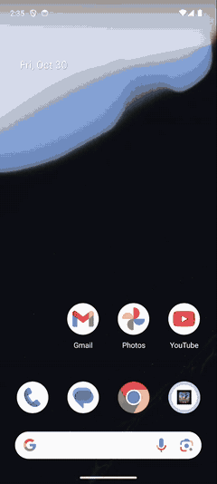 | 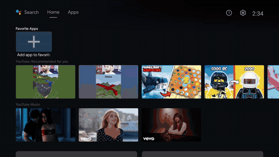 |
| [▶ סרטון מלא](https://dor2500.github.io/israel-tv-plus/docs/media/demo-phone.mp4) | [▶ סרטון מלא](https://dor2500.github.io/israel-tv-plus/docs/media/demo-tv.mp4) |

## ⚡ התקנה מהירה ב-Windows

פותחים PowerShell ומדביקים:

```powershell
irm https://dor2500.github.io/israel-tv-plus/install.ps1 | iex
```

הפקודה מורידה את הגרסה האחרונה מ-[Releases](https://github.com/dor2500/israel-tv-plus/releases/latest), בודקת את חתימת ה-SHA-256 שלה ומתקינה בשקט. אפשר [לקרוא את הסקריפט](install.ps1) לפני ההרצה.

## 📲 הורדה

| מכשיר | קובץ | הערות |
|---|---|---|
| 📺 **LG webOS** | [com.israeltv.plus_all.ipk](https://github.com/dor2500/israel-tv-plus/releases/latest/download/com.israeltv.plus_all.ipk) | התקנה ב-Developer Mode (ראו למטה) |
| 📺 **Android TV / Google TV / Fire TV** | [IsraelTVPlus-androidtv.apk](https://github.com/dor2500/israel-tv-plus/releases/latest/download/IsraelTVPlus-androidtv.apk) | דרך "Downloader" (להקליד את הקישור) / USB; מופיע במסך הבית עם באנר |
| 🤖 **אנדרואיד** (טלפון / טאבלט) | [IsraelTVPlus-android.apk](https://github.com/dor2500/israel-tv-plus/releases/latest/download/IsraelTVPlus-android.apk) | |
| 🪟 **Windows** | [פקודת PowerShell](#-התקנה-מהירה-ב-windows) · [התקנה](https://github.com/dor2500/israel-tv-plus/releases/latest/download/IsraelTVPlus-windows-setup.exe) · [ZIP נייד](https://github.com/dor2500/israel-tv-plus/releases/latest/download/IsraelTVPlus-windows-portable.zip) | |
| 🍏 **Mac** | [Apple Silicon](https://github.com/dor2500/israel-tv-plus/releases/latest/download/IsraelTVPlus-macos-arm64.zip) · [Intel](https://github.com/dor2500/israel-tv-plus/releases/latest/download/IsraelTVPlus-macos-x64.zip) | בפעם הראשונה: `xattr -cr "/Applications/Israel TV Plus.app"` |
| 🐧 **Linux** | [x64](https://github.com/dor2500/israel-tv-plus/releases/latest/download/IsraelTVPlus-linux-x64.zip) · [ARM64 / Raspberry Pi](https://github.com/dor2500/israel-tv-plus/releases/latest/download/IsraelTVPlus-linux-arm64.zip) | |
| 🔷 **Samsung Tizen** | [פרויקט](https://github.com/dor2500/israel-tv-plus/releases/latest/download/IsraelTVPlus-tizen-project.zip) | נדרשת חתימה ב-Tizen Studio (תעודת סמסונג) |
| 🎬 **Stremio** | [התקנת ההרחבה](https://dor2500.github.io/israel-tv-plus/stremio/) | או להדביק בחיפוש התוספים: `https://dor2500.github.io/israel-tv-plus/stremio/manifest.json` |
| 🎬 **Kodi** (19 ומעלה) | [תוסף להתקנה מ-zip](https://github.com/dor2500/israel-tv-plus/releases/latest) | Add-ons ← Install from zip file |
| 📋 **נגני IPTV** (Kodi, VLC, TiviMate...) | [playlist.m3u](https://dor2500.github.io/israel-tv-plus/playlist.m3u) | גם [ישראל בלבד](https://dor2500.github.io/israel-tv-plus/playlist-israel.m3u) · [טלוויזיה](https://dor2500.github.io/israel-tv-plus/playlist-tv.m3u) · [רדיו](https://dor2500.github.io/israel-tv-plus/radio.m3u) |
| 🍎 **iPhone / iPad** | [האתר](https://dor2500.github.io/israel-tv-plus/) | Safari ← שיתוף ← הוספה למסך הבית |
| 🏠 **Home Assistant** | [התקנה ישירה בלחיצה אחת](https://my.home-assistant.io/redirect/hacs_repository/?owner=dor2500&repository=israel-tv-plus&category=integration) · [קובץ ZIP](https://github.com/dor2500/israel-tv-plus/releases/latest/download/IsraelTVPlus-homeassistant.zip) · [מדריך מלא](platforms/homeassistant/README.md) | תמיכה מלאה ב-HACS, דפדפן המדיה Media Browser וכרטיס Lovelace |

> ערוצים שמשדרים ב-HTTP: באפליקציות הם פועלים תמיד. בדפדפן הם עוברים דרך שרת ממסר HTTPS קטן (`relay/` – Cloudflare Worker) כשהוא פעיל; בלעדיו הם מסומנים 📲.

## 🏠 התקנה מהירה ב-Home Assistant (בלחיצה אחת)

הוסיפו את ישראל TV+ ישירות למערכת Home Assistant שלכם בלחיצה אחת:

[](https://my.home-assistant.io/redirect/hacs_repository/?owner=dor2500&repository=israel-tv-plus&category=integration)

לאחר מכן הפעילו את השילוב ישירות ב-Home Assistant:

[](https://my.home-assistant.io/redirect/config_flow_start/?domain=israel_tv_plus)

פתחו את לוחות הבקרה (Dashboards) להוספת כרטיס שלט:

[](https://my.home-assistant.io/redirect/lovelace_dashboards/)

או התקינו כתוסף לסרגל הצד (Add-on):

[](https://my.home-assistant.io/redirect/supervisor_add_addon_repository/?repository_url=https%3A%2F%2Fgithub.com%2Fdor2500%2Fisrael-tv-plus)


## 📡 מקורות שידור, שרתי CDN וארכיטקטורת שידור (Broadcast Sources & Infrastructure)

כל ערוץ באפליקציה מחזיק מקור ראשי מאומת ושרת גיבוי חי עם מנגנון מעבר שקוף (Dual-Origin Failover):

| קבוצת ערוצים | שרתי מקור ו-CDN עיקריים | מנגנון גיבוי ואיכות |
|---|---|---|
| **כאן 11, מכאן 33, כאן חינוכית 23** | Kaltura CDN / AWS CloudFront רשמי של תאגיד השידור הישראלי | שרתי גיבוי ישירים Ottrast / Akamai ב-1080p |
| **קשת 12** | Mako Live Origin / FreeTV CloudFront subs | זרם ראשי 1080p + שרת גיבוי מבוסס תשתית שידור ארצית |
| **רשת 13** | 13tv.co.il Akamai Edge / FreeTV CloudFront | זרם ישיר ללא פרסומות + שרת גיבוי אוטומטי |
| **עכשיו 14** | Channel 14 Live Origin (AWS CloudFront / Wowza) | זרם רשמי ישיר FHD + שרת גיבוי Ottrast |
| **i24NEWS עברית (15), ערוץ 16** | Fastly / Official Global CDN | זרם ישיר רשמי באיכות 1080p |
| **ערוץ 9 הישראלי (9), כלכלה 10** | Channel 9 Live Origin / Calcala10 Stream | שידור ישיר מהאולפנים |
| **ערוצי ספורט ישראליים (48–60)** | FreeTV Edge / Sport 5 CDN / ONE Video Delivery | כולל ספורט 5 4K, 5 לייב, 5 גולד, ONE 1-2, ONE דוקו וספורט 1-4 |
| **ערוצי ילדים ישראליים (61–87)** | ערוץ הילדים, לוגי, הופ!, ילדותי, לולי, דיסני, ניקלודיאון (PlayMedia / CloudFront) | זרמים ישירים נקיים בעברית ללא דיליי |
| **רדיו ישראלי (136 תחנות)** | StreamTheWorld / תחנות אזוריות וגלגלצ Origin | שמע סטריאו נקי 128-320kbps |

### 🛠️ בקרת איכות שידור, שדרוג 4K ומניעת תקיעות (Anti-Stutter Buffer Engine)
- **השבחה ל-4K / Ultra Sharp**: אלגוריתם שדרוג חדות וקונטרסט בחומרה (Hardware-Accelerated Super-Resolution) המאפשר שדרוג שידורי 420p / 480p / 720p לתמונה חדה ועשירה גם על גבי מסכי 4K גדולים.
- **הורדת איכות יזומה (1080p / 720p / 480p / 360p)**: שליטה מלאה ברזולוציה – מעבר מהיר לרזולוציה קלה יותר ברשתות חלשות או סלולריות למניעת עצירות.
- **מנגנון אנטי-תקיעות (Adaptive Buffer Watchdog)**: אגירה מוגדלת (עד 60 שניות buffer), ניטור תקיעות אוטומטי והתאמת קצב נתונים אוטומטית המבטיחה שידור חלק ורציף לחלוטין ללא גמגומים ("Micro-stutters").

### 🔢 מספור שלט קנוני נוח
הקשת הספרה בשלט מעבירה ישירות לערוץ המתאים:
`9` (ערוץ 9) · `10` (כלכלה 10) · `11` (כאן 11) · `12` (קשת 12) · `13` (רשת 13) · `14` (עכשיו 14) · `15` (i24NEWS) · `16` (ערוץ 16) · `23` (כאן חינוכית) · `24` (ערוץ 24) · `48-60` (ערוצי ספורט) · `61-87` (ערוצי ילדים) · `98` (ערוץ 98) · `99` (הכנסת).

## ⬆️ עדכונים

- **אונליין, בכל המכשירים:** כשמתפרסמת גרסה, האפליקציה מורידה ברקע את המסך, הקוד ורשימת הערוצים החדשים מ-GitHub ומפעילה אותם בפתיחה הבאה – גם בטלוויזיות LG וסמסונג, בלי להתקין מחדש. אם עדכון לא נטען (אין רשת, תקלה) – עולה הגרסה המותקנת.
- **גרסה חדשה של האפליקציה עצמה:** כפתור "עדכון זמין" למעלה. באנדרואיד וב-Windows – הורדה והתקנה בלחיצה; בשאר המכשירים – קישור לקובץ. **ב-LG הכל אוטומטי**: אין צורך להתקין IPK מחדש – העדכון יורד לבד (בפתיחה ובכל 6 שעות) ומופעל מיד כשלא צופים בערוץ, או כשחוזרים לאפליקציה.
- הגדרות ← עדכונים: בדיקה ידנית, כיבוי עדכון אונליין, מה הגרסה הפעילה.

## ✨ מה יש באפליקציה

| | |
|---|---|
| 📺 **ממשק לטלוויזיה** | כרטיסים וטקסטים גדולים, מסגרת פוקוס בולטת, נבנה למסך 1920×1080 ומתאים את עצמו ל-720p / 4K. "גודל ממשק" בהגדרות (עד ×1.5) |
| ⚡ **מהיר** | בלי אפקטים כבדים; זיהוי מכשיר חלש (דגם הטלוויזיה / זיכרון / גרסת דפדפן) ומעבר אוטומטי למצב מהיר |
| 🎮 **שלט רחוק לכל טלוויזיה** | זיהוי LG / סמסונג / Android TV / מקלדת / מגע. הסברים במסך לפי סוג השלט. **לחיצה ארוכה על OK** = תפריט אפשרויות (מועדף, מידע, דיבוב...) – גם בשלטים בלי כפתורי צבע. לכל כפתור צבע אפשר לבחור פעולה |
| ℹ️ **מקור השידור** | בכל ערוץ: מי משדר, אם זה שידור רשמי / ערוץ FAST / ממסר צד שלישי, השרת והכתובת |
| 🎙️ **דיבוב לעברית** | ערוצים זרים מתורגמים ומוקראים בעברית בזמן אמת, עם כתוביות וסנכרון שפתיים (Gemini / OpenAI / Whisper מקומי) |
| ⚙️ **הגדרות מלאות** | תצוגה, ערוצים (הסתרה, קטגוריות, פתיחה), נגן (תמונה, גודל, איכות, השהיה), שלט, דיבוב, מצב ילדים, שומר מסך, עדכונים, פרטי מכשיר |
| 🧸 **מצב ילדים** | רק ערוצי ילדים, יציאה עם קוד של 4 ספרות |
| ⭐ **ועוד** | מועדפים, "צפית לאחרונה", הקלדת מספר ערוץ, רשימת ערוצים בתוך הנגן, חיפוש, מצב OLED / כהה / בהיר, שומר מסך |

### 📱 בטלפון

| | | |
|---|---|---|
| 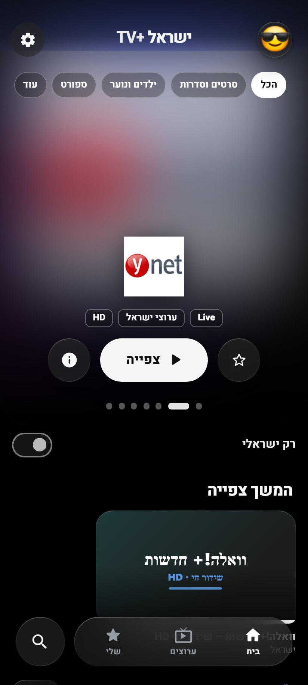 | 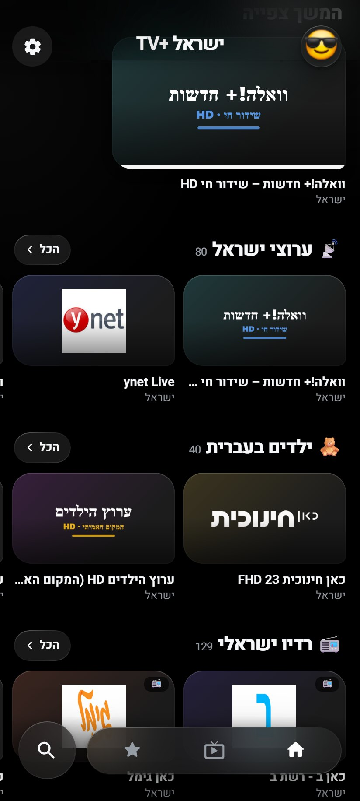 | 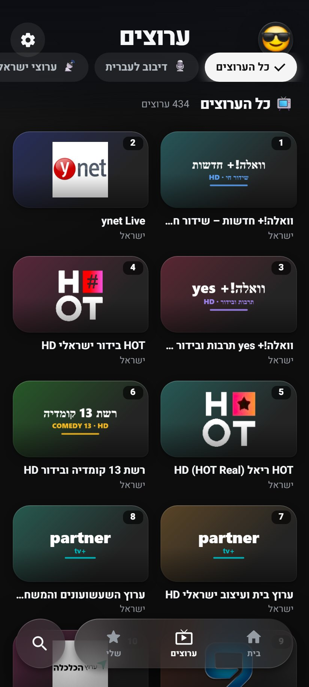 |
| 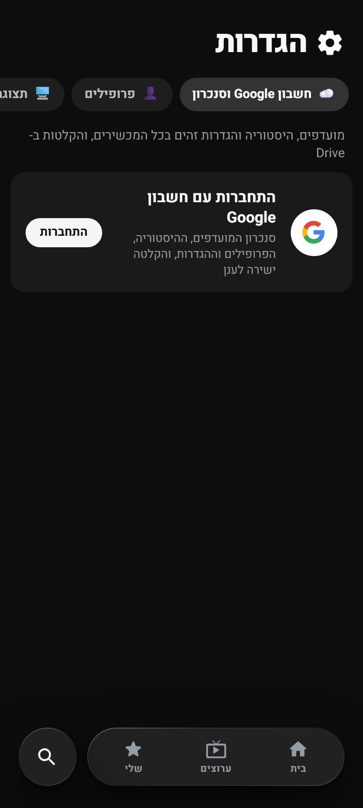 | 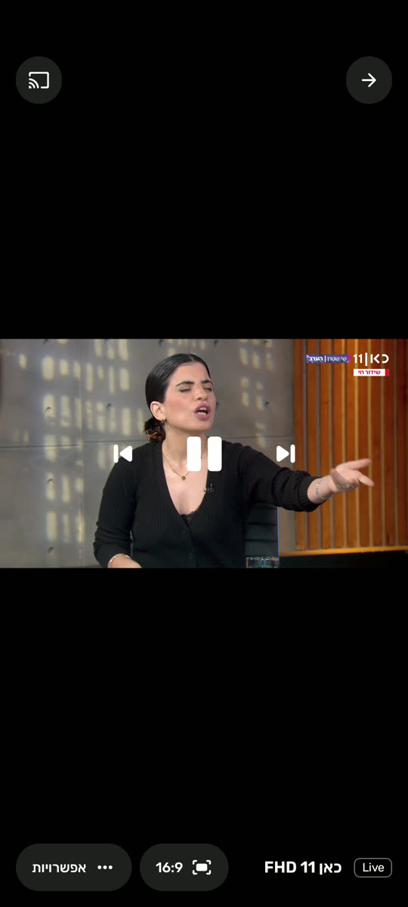 | 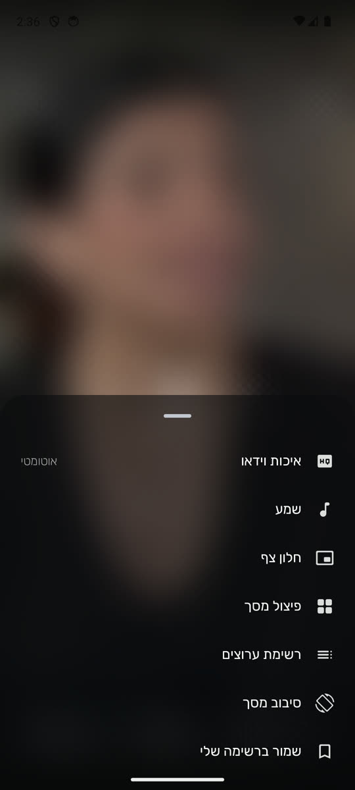 |

### 📺 במחשב ובטלוויזיה

| | |
|---|---|
| 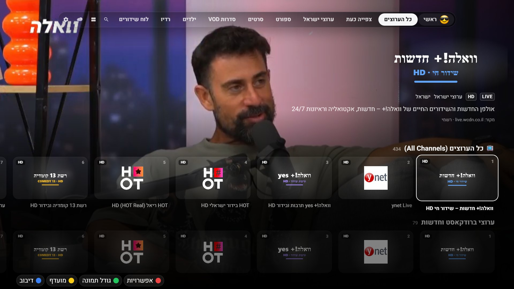 | 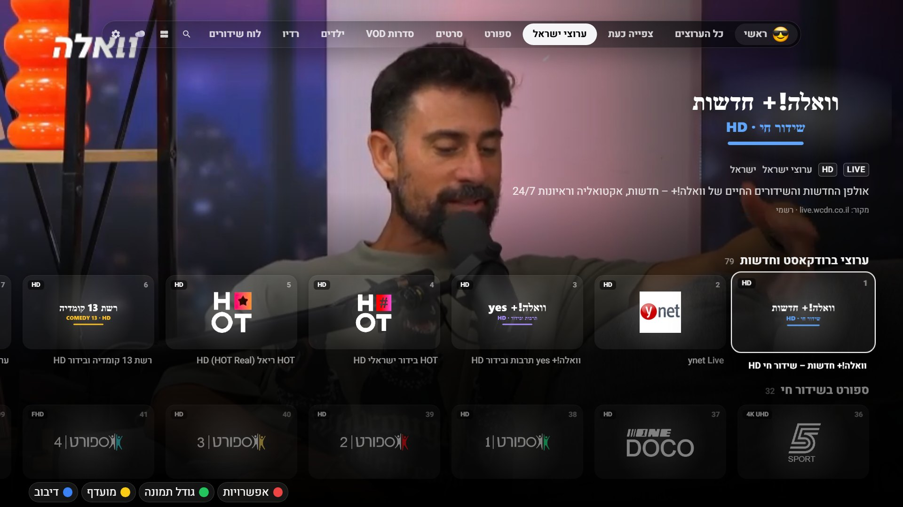 |
| 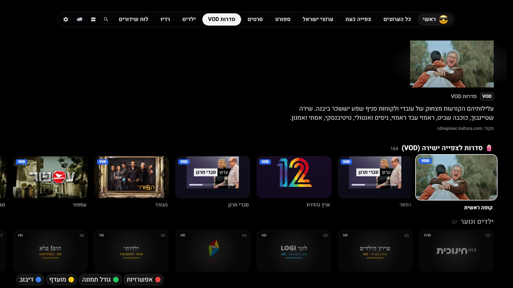 | 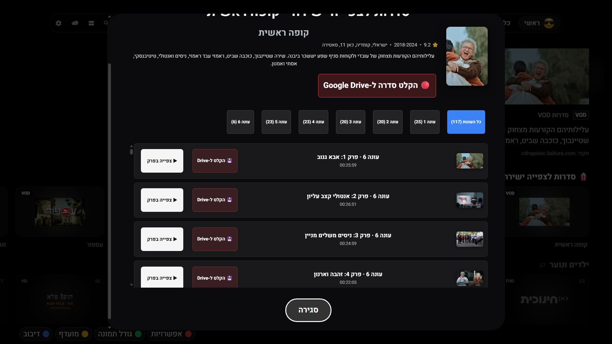 |
| 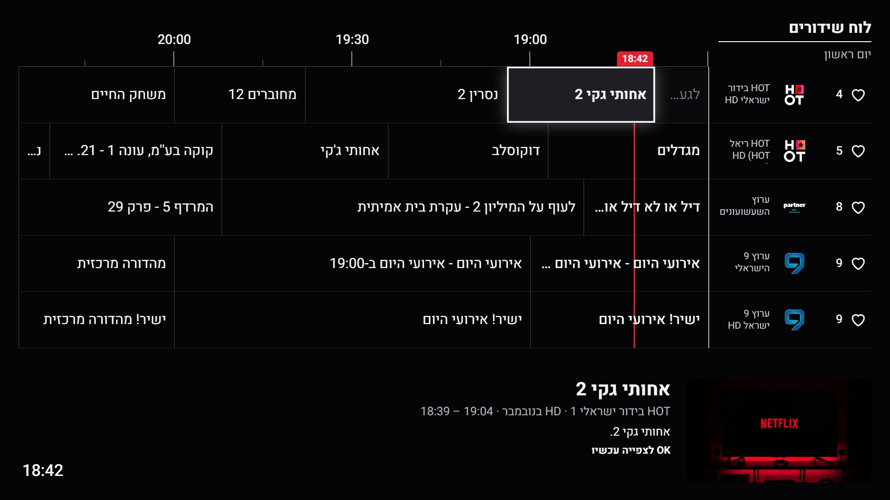 | 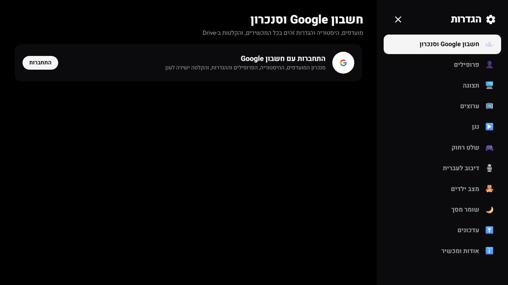 |

### ⌚ בשעון (Wear OS)

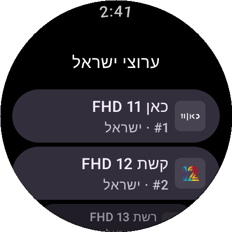 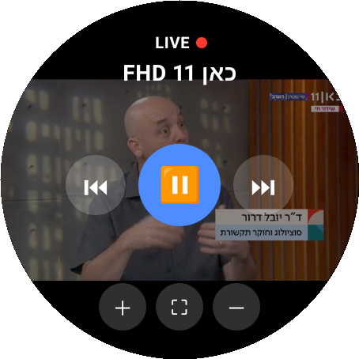

## 🎮 שלט רחוק

| מקש | במדריך | בצפייה |
|---|---|---|
| חצים | ניווט | ▲▼ החלפת ערוץ · ◄ רשימת ערוצים · ► אפשרויות |
| OK | צפייה | פרטי הערוץ / תפריט אפשרויות |
| **OK ארוך** | תפריט אפשרויות לערוץ | תפריט הנגן (תמונה, גודל, איכות, דיבוב...) |
| BACK | חזרה (פעמיים במסך הראשי = יציאה) | חזרה למדריך – השידור ממשיך |
| 0-9 | מעבר לערוץ לפי מספר | |
| CH ▲▼ | גלילת עמוד | החלפת ערוץ |
| 🔴 🟢 🟡 🔵 | ברירת מחדל: אפשרויות · גודל תמונה · מועדף · דיבוב – **ניתן לשינוי** בהגדרות ← שלט רחוק | |
| מקלדת | Enter · O / קליק ימני = אפשרויות · / חיפוש · S הגדרות · F מסך מלא · D דיבוב | |

ב-LG Magic Remote בלי כפתורי צבע: כפתור **···** בשלט מציג אותם במסך, או פשוט לחיצה ארוכה על OK.

## 🖥️ התקנה בטלוויזיית LG (Developer Mode)

1. בטלוויזיה: LG Content Store ← **Developer Mode** ← התחברות עם חשבון LG Developer ← הפעלת Dev Mode Status + **Key Server**.
2. במחשב: `npm install -g @webos-tools/cli`, ואז `ares-setup-device` (כתובת ה-IP של הטלוויזיה, פורט 9922, משתמש `prisoner`) ו-`ares-novacom --device tv --getkey` (הסיסמה מוצגת באפליקציית Developer Mode).
3. `ares-install --device tv com.israeltv.plus_all.ipk`
4. מצב המפתח נגמר אחרי זמן מוגבל – מאריכים אותו באפליקציית Developer Mode (Extend). אחרי ההתקנה, המסך, הקוד והערוצים מתעדכנים אונליין.

אפשר גם עם [webOS Dev Manager](https://github.com/webosbrew/dev-manager-desktop) (גרירת ה-IPK).

## ⚖️ מקורות וזכויות

הערוצים נאספו ממאגרים ציבוריים ([iptv-org](https://github.com/iptv-org/iptv), [radio-browser.info](https://www.radio-browser.info/)) ומהשרתים של הגופים עצמם, וכל אחד נבדק עם תמונה אמיתית. **143 שידורים רשמיים, 554 ערוצי FAST רשמיים, 2206 ערוצים פתוחים מהעולם (iptv-org), 146 ממסרי צד שלישי** – הפירוט המלא לכל ערוץ ב-[SOURCES.md](SOURCES.md) ובתוך האפליקציה (מידע ומקור השידור).

## 🛠️ פיתוח

```text
index.html, boot.js   שלד + טוען (בוחר בין הגרסה המותקנת לגרסה החדשה מ-GitHub)
ui.js, style.css      המסך והעיצוב
app.js                המדריך, הנגן, ההגדרות, השלט, העדכונים
dub.js                מנוע הדיבוב לעברית
channels.json / .js   רשימת הערוצים (כולל מקור כל שידור)
version.js / .json    הגרסה (tools/make_version.py מ-VERSION ו-CHANGELOG.md)
platforms/            אנדרואיד (Java), Windows (C#), Linux/Mac (Electron), סמסונג (Tizen), Kodi (Python)
stremio/              ההרחבה ל-Stremio (קבצי JSON סטטיים)
tools/                בנייה ובדיקות
```

| שלב | פקודה |
|---|---|
| ערוצים ישראליים / תיקונים (כל שידור נבדק) | `python -I tools/add_israeli.py` |
| בדיקת כל הערוצים עם תמונה מכל ערוץ | `python -I tools/check_channels.py <out_dir>` |
| מקורות (SOURCES.md + מקור בכל ערוץ) | `python -I tools/make_sources.py` |
| פלייליסטים M3U / הרחבת Stremio | `python -I tools/make_playlists.py` · `python -I tools/make_stremio.py` |
| גרסה (אחרי עדכון VERSION ו-CHANGELOG.md) | `python -I tools/make_version.py` |
| חבילות | `tools/build_apk.ps1` · `tools/build_windows.ps1` · `python -I tools/build_ipk.py` · `python -I tools/build_desktop.py` · `tools/build_tizen.ps1` |

קבצי האפליקציה שנכנסים לכל החבילות מפורטים ב-`tools/webfiles.txt`. האתר (GitHub Pages) מתפרסם מענף `master` – כל מיזוג מגיע אוטומטית גם לאפליקציות המותקנות.
