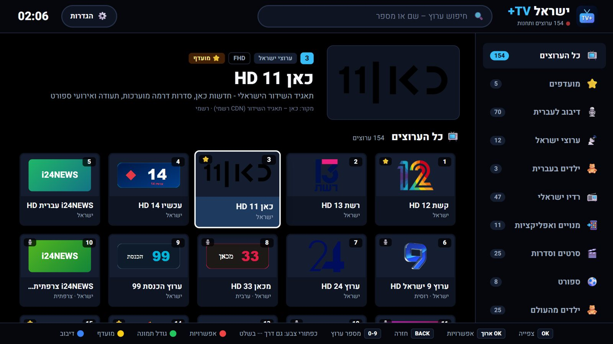
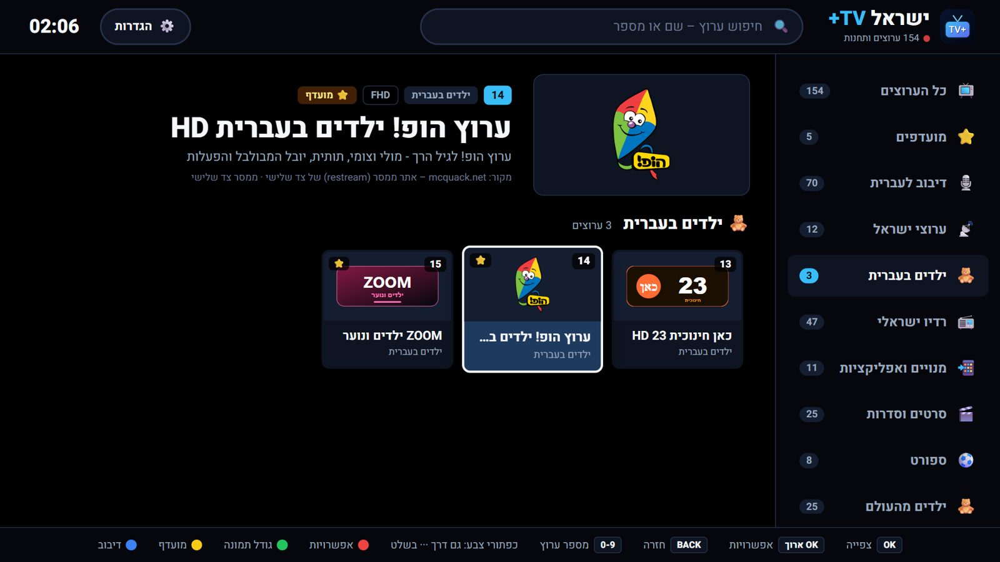
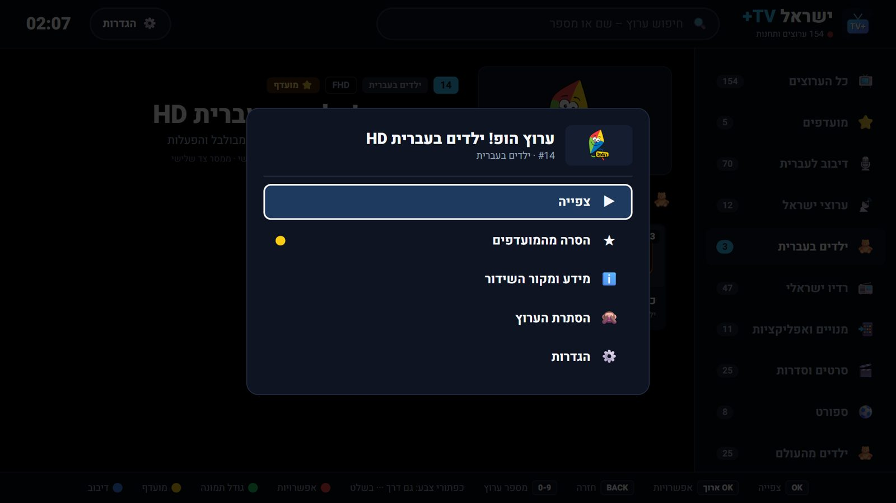
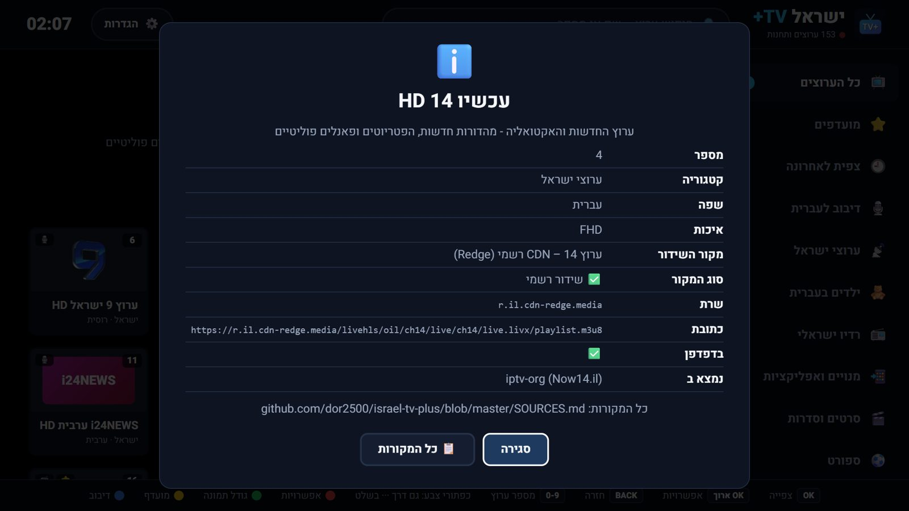
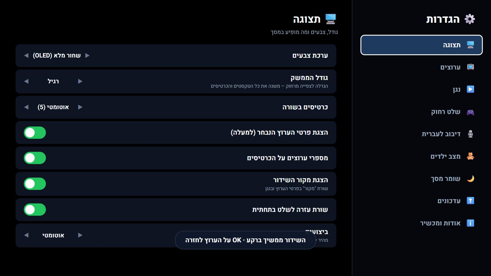
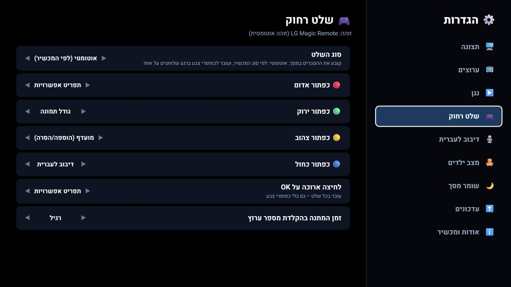
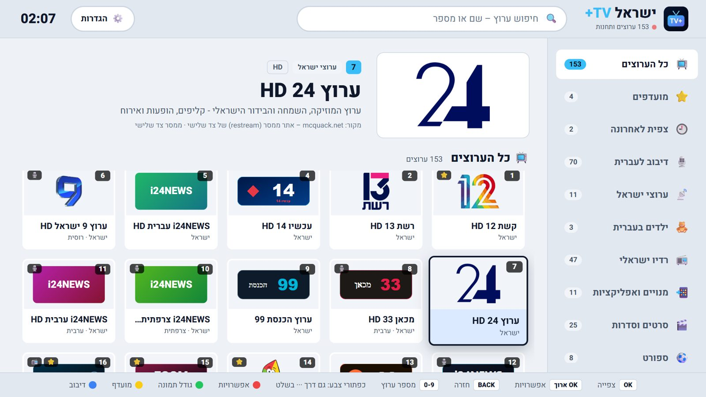

# ישראל TV+ | Israel TV Plus 🇮🇱 📺

ערוצי טלוויזיה ותחנות רדיו ישראליות בשידור חי – **לטלוויזיה (LG, סמסונג, Android TV), לאנדרואיד, למחשב, לדפדפן ול-Stremio**.
**1589 ערוצים ותחנות מ-156 מדינות**: ערוצי ישראל, ילדים בעברית, 100 תחנות רדיו, חדשות, סרטים, ספורט, אוכל ובישול, טיולים, מדע, כלכלה, קומדיה, דוקו, מוזיקה וערוצים מכל העולם עם **דיבוב חי לעברית**. באנדרואיד (טלפון וטאבלט): אפליקציה מקורית ב-Jetpack Compose – עיצוב "זכוכית" של Material 3 Expressive + Apple TV בצבעי הטפט (Material You), עם גלילה וקפיצה כמו באייפון (אנדרואיד 7 ומעלה); בטלוויזיה: בסגנון Nuvio.

**▶ צפייה בדפדפן:** https://dor2500.github.io/israel-tv-plus/ · **📺 כל הערוצים:** [CHANNELS.md](CHANNELS.md) · **📋 מאיפה מגיע כל ערוץ:** [SOURCES.md](SOURCES.md) · **🆕 מה חדש:** [CHANGELOG.md](CHANGELOG.md)



## 📲 הורדה

| מכשיר | קובץ | הערות |
|---|---|---|
| 📺 **LG webOS** | [com.israeltv.plus_all.ipk](https://github.com/dor2500/israel-tv-plus/releases/latest/download/com.israeltv.plus_all.ipk) | התקנה ב-Developer Mode (ראו למטה) |
| 📺 **Android TV / Google TV / Fire TV** | [IsraelTVPlus-androidtv.apk](https://github.com/dor2500/israel-tv-plus/releases/latest/download/IsraelTVPlus-androidtv.apk) | דרך "Downloader" (להקליד את הקישור) / USB; מופיע במסך הבית עם באנר |
| 🤖 **אנדרואיד** (טלפון / טאבלט) | [IsraelTVPlus-android.apk](https://github.com/dor2500/israel-tv-plus/releases/latest/download/IsraelTVPlus-android.apk) | |
| 🪟 **Windows** | [התקנה](https://github.com/dor2500/israel-tv-plus/releases/latest/download/IsraelTVPlus-windows-setup.exe) · [ZIP נייד](https://github.com/dor2500/israel-tv-plus/releases/latest/download/IsraelTVPlus-windows-portable.zip) | |
| 🍏 **Mac** | [Apple Silicon](https://github.com/dor2500/israel-tv-plus/releases/latest/download/IsraelTVPlus-macos-arm64.zip) · [Intel](https://github.com/dor2500/israel-tv-plus/releases/latest/download/IsraelTVPlus-macos-x64.zip) | בפעם הראשונה: `xattr -cr "/Applications/Israel TV Plus.app"` |
| 🐧 **Linux** | [x64](https://github.com/dor2500/israel-tv-plus/releases/latest/download/IsraelTVPlus-linux-x64.zip) · [ARM64 / Raspberry Pi](https://github.com/dor2500/israel-tv-plus/releases/latest/download/IsraelTVPlus-linux-arm64.zip) | |
| 🔷 **Samsung Tizen** | [פרויקט](https://github.com/dor2500/israel-tv-plus/releases/latest/download/IsraelTVPlus-tizen-project.zip) | נדרשת חתימה ב-Tizen Studio (תעודת סמסונג) |
| 🎬 **Stremio** | [התקנת ההרחבה](https://dor2500.github.io/israel-tv-plus/stremio/) | או להדביק בחיפוש התוספים: `https://dor2500.github.io/israel-tv-plus/stremio/manifest.json` |
| 📋 **נגני IPTV** (Kodi, VLC, TiviMate...) | [playlist.m3u](https://dor2500.github.io/israel-tv-plus/playlist.m3u) | גם [ישראל בלבד](https://dor2500.github.io/israel-tv-plus/playlist-israel.m3u) · [טלוויזיה](https://dor2500.github.io/israel-tv-plus/playlist-tv.m3u) · [רדיו](https://dor2500.github.io/israel-tv-plus/radio.m3u) |
| 🍎 **iPhone / iPad** | [האתר](https://dor2500.github.io/israel-tv-plus/) | Safari ← שיתוף ← הוספה למסך הבית |

> ערוצים שמשדרים ב-HTTP: באפליקציות הם פועלים תמיד. בדפדפן הם עוברים דרך שרת ממסר HTTPS קטן (`relay/` – Cloudflare Worker) כשהוא פעיל; בלעדיו הם מסומנים 📲.

## ⬆️ עדכונים

- **אונליין, בכל המכשירים:** כשמתפרסמת גרסה, האפליקציה מורידה ברקע את המסך, הקוד ורשימת הערוצים החדשים מ-GitHub ומפעילה אותם בפתיחה הבאה – גם בטלוויזיות LG וסמסונג, בלי להתקין מחדש. אם עדכון לא נטען (אין רשת, תקלה) – עולה הגרסה המותקנת.
- **גרסה חדשה של האפליקציה עצמה:** כפתור "עדכון זמין" למעלה. באנדרואיד וב-Windows – הורדה והתקנה בלחיצה; בשאר המכשירים – קישור לקובץ.
- הגדרות ← עדכונים: בדיקה ידנית, כיבוי עדכון אונליין, מה הגרסה הפעילה.

## ✨ מה יש באפליקציה

| | |
|---|---|
| 📺 **ממשק לטלוויזיה** | כרטיסים וטקסטים גדולים, מסגרת פוקוס בולטת, נבנה למסך 1920×1080 ומתאים את עצמו ל-720p / 4K. "גודל ממשק" בהגדרות (עד ×1.5) |
| ⚡ **מהיר** | בלי אפקטים כבדים; זיהוי מכשיר חלש (דגם הטלוויזיה / זיכרון / גרסת דפדפן) ומעבר אוטומטי למצב מהיר |
| 🎮 **שלט רחוק לכל טלוויזיה** | זיהוי LG / סמסונג / Android TV / מקלדת / מגע. הסברים במסך לפי סוג השלט. **לחיצה ארוכה על OK** = תפריט אפשרויות (מועדף, מידע, דיבוב...) – גם בשלטים בלי כפתורי צבע. לכל כפתור צבע אפשר לבחור פעולה |
| ℹ️ **מקור השידור** | בכל ערוץ: מי משדר, אם זה שידור רשמי / ערוץ FAST / ממסר צד שלישי, השרת והכתובת |
| 🎙️ **דיבוב לעברית** | ערוצים זרים מתורגמים ומוקראים בעברית בזמן אמת, עם כתוביות וסנכרון שפתיים (Gemini / OpenAI / Whisper מקומי) |
| ⚙️ **הגדרות מלאות** | תצוגה, ערוצים (הסתרה, קטגוריות, פתיחה), נגן (תמונה, גודל, איכות, השהיה), שלט, דיבוב, מצב ילדים, שומר מסך, עדכונים, פרטי מכשיר |
| 🧸 **מצב ילדים** | רק ערוצי ילדים, יציאה עם קוד של 4 ספרות |
| ⭐ **ועוד** | מועדפים, "צפית לאחרונה", הקלדת מספר ערוץ, רשימת ערוצים בתוך הנגן, חיפוש, מצב OLED / כהה / בהיר, שומר מסך |

| | |
|---|---|
|  |  |
|  |  |
|  |  |

## 🎮 שלט רחוק

| מקש | במדריך | בצפייה |
|---|---|---|
| חצים | ניווט | ▲▼ החלפת ערוץ · ◄ רשימת ערוצים · ► אפשרויות |
| OK | צפייה | פרטי הערוץ / תפריט אפשרויות |
| **OK ארוך** | תפריט אפשרויות לערוץ | תפריט הנגן (תמונה, גודל, איכות, דיבוב...) |
| BACK | חזרה (פעמיים במסך הראשי = יציאה) | חזרה למדריך – השידור ממשיך |
| 0-9 | מעבר לערוץ לפי מספר | |
| CH ▲▼ | גלילת עמוד | החלפת ערוץ |
| 🔴 🟢 🟡 🔵 | ברירת מחדל: אפשרויות · גודל תמונה · מועדף · דיבוב – **ניתן לשינוי** בהגדרות ← שלט רחוק | |
| מקלדת | Enter · O / קליק ימני = אפשרויות · / חיפוש · S הגדרות · F מסך מלא · D דיבוב | |

ב-LG Magic Remote בלי כפתורי צבע: כפתור **···** בשלט מציג אותם במסך, או פשוט לחיצה ארוכה על OK.

## 🖥️ התקנה בטלוויזיית LG (Developer Mode)

1. בטלוויזיה: LG Content Store ← **Developer Mode** ← התחברות עם חשבון LG Developer ← הפעלת Dev Mode Status + **Key Server**.
2. במחשב: `npm install -g @webos-tools/cli`, ואז `ares-setup-device` (כתובת ה-IP של הטלוויזיה, פורט 9922, משתמש `prisoner`) ו-`ares-novacom --device tv --getkey` (הסיסמה מוצגת באפליקציית Developer Mode).
3. `ares-install --device tv com.israeltv.plus_all.ipk`
4. מצב המפתח נגמר אחרי זמן מוגבל – מאריכים אותו באפליקציית Developer Mode (Extend). אחרי ההתקנה, המסך, הקוד והערוצים מתעדכנים אונליין.

אפשר גם עם [webOS Dev Manager](https://github.com/webosbrew/dev-manager-desktop) (גרירת ה-IPK).

## ⚖️ מקורות וזכויות

הערוצים נאספו ממאגרים ציבוריים ([iptv-org](https://github.com/iptv-org/iptv), [radio-browser.info](https://www.radio-browser.info/)) ומהשרתים של הגופים עצמם, וכל אחד נבדק עם תמונה אמיתית. **113 שידורים רשמיים, 175 ערוצי FAST רשמיים, 1173 ערוצים פתוחים מהעולם (iptv-org), 98 ממסרי צד שלישי** – הפירוט המלא לכל ערוץ ב-[SOURCES.md](SOURCES.md) ובתוך האפליקציה (מידע ומקור השידור).

## 🛠️ פיתוח

```text
index.html, boot.js   שלד + טוען (בוחר בין הגרסה המותקנת לגרסה החדשה מ-GitHub)
ui.js, style.css      המסך והעיצוב
app.js                המדריך, הנגן, ההגדרות, השלט, העדכונים
dub.js                מנוע הדיבוב לעברית
channels.json / .js   רשימת הערוצים (כולל מקור כל שידור)
version.js / .json    הגרסה (tools/make_version.py מ-VERSION ו-CHANGELOG.md)
platforms/            אנדרואיד (Java), Windows (C#), Linux/Mac (Electron), סמסונג (Tizen)
stremio/              ההרחבה ל-Stremio (קבצי JSON סטטיים)
tools/                בנייה ובדיקות
```

| שלב | פקודה |
|---|---|
| ערוצים ישראליים / תיקונים (כל שידור נבדק) | `python -I tools/add_israeli.py` |
| בדיקת כל הערוצים עם תמונה מכל ערוץ | `python -I tools/check_channels.py <out_dir>` |
| מקורות (SOURCES.md + מקור בכל ערוץ) | `python -I tools/make_sources.py` |
| פלייליסטים M3U / הרחבת Stremio | `python -I tools/make_playlists.py` · `python -I tools/make_stremio.py` |
| גרסה (אחרי עדכון VERSION ו-CHANGELOG.md) | `python -I tools/make_version.py` |
| חבילות | `tools/build_apk.ps1` · `tools/build_windows.ps1` · `python -I tools/build_ipk.py` · `python -I tools/build_desktop.py` · `tools/build_tizen.ps1` |

קבצי האפליקציה שנכנסים לכל החבילות מפורטים ב-`tools/webfiles.txt`. האתר (GitHub Pages) מתפרסם מענף `master` – כל מיזוג מגיע אוטומטית גם לאפליקציות המותקנות.
