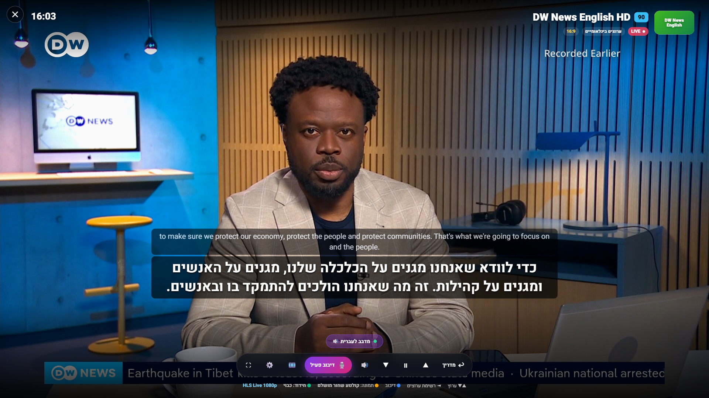
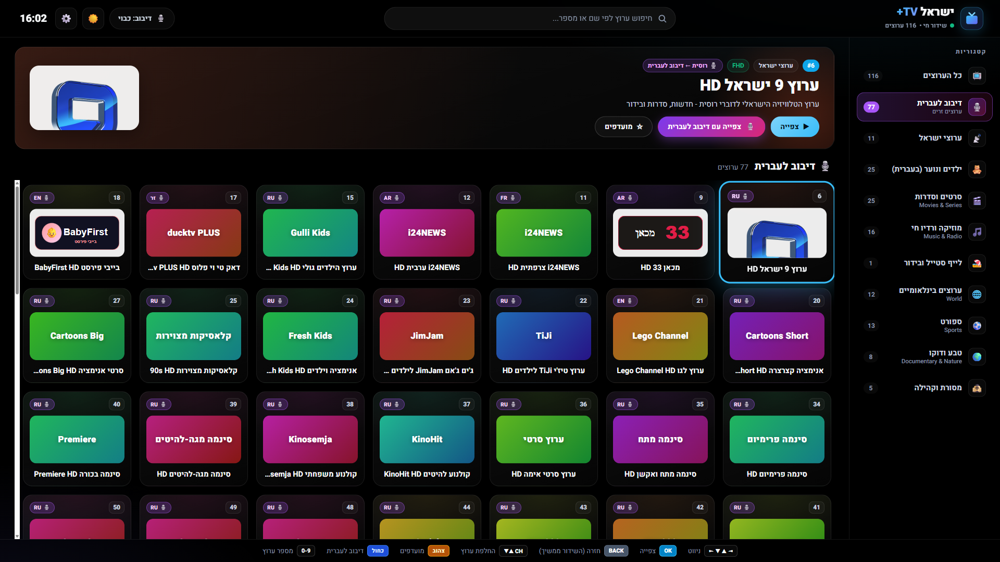
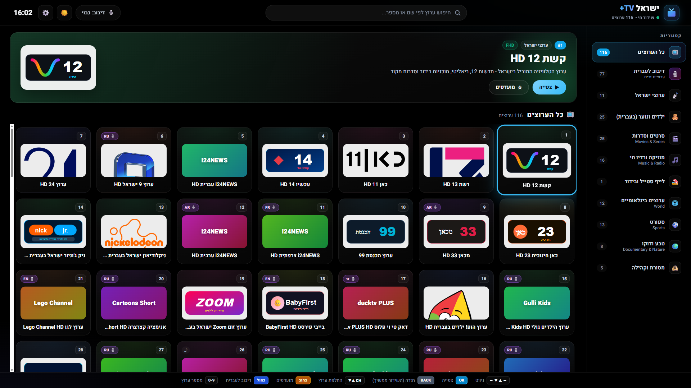
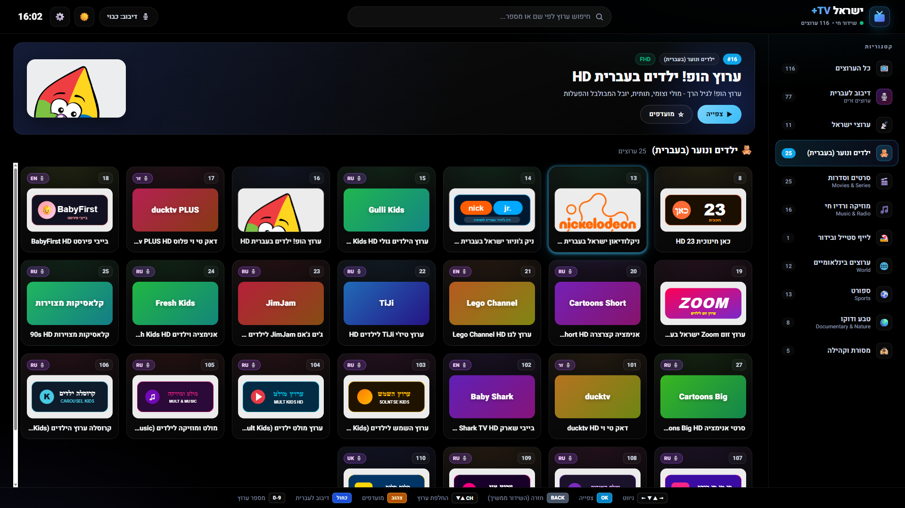
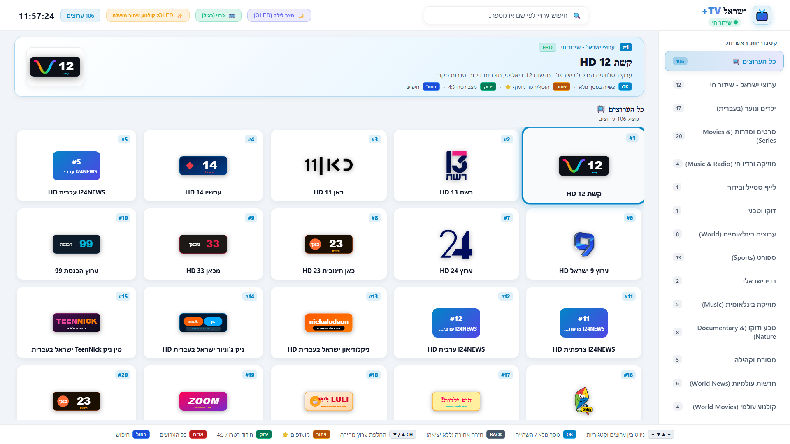
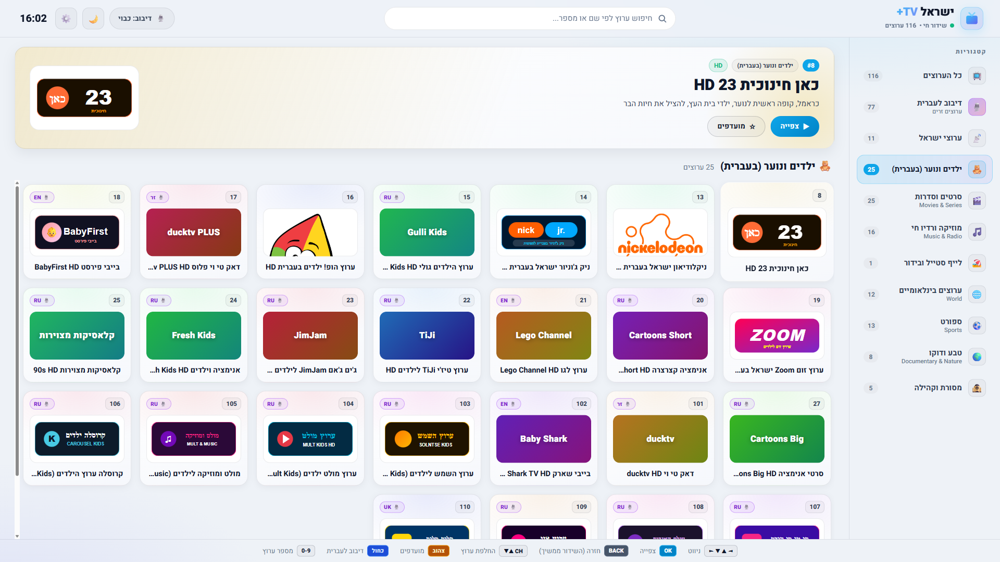

# Israel TV Plus – Web, Android, Android TV, Windows, LG & Samsung 🇮🇱 📺

## 📲 הורדה לכל הפלטפורמות (v2.0)

| פלטפורמה | קובץ | התקנה |
|---|---|---|
| 🤖 **אנדרואיד** (טלפון/טאבלט) + 📺 **Android TV / Google TV / Fire TV** | [IsraelTVPlus-android.apk](https://github.com/dor2500/israel-tv-plus/releases/latest/download/IsraelTVPlus-android.apk) | אותו APK לכולם. בטלוויזיה: התקנה דרך "Downloader" / כונן USB, האפליקציה מופיעה במסך הבית של ה-TV |
| 🪟 **Windows 10/11** | [התקנה](https://github.com/dor2500/israel-tv-plus/releases/latest/download/IsraelTVPlus-windows-setup.exe) · [נייד ZIP](https://github.com/dor2500/israel-tv-plus/releases/latest/download/IsraelTVPlus-windows-portable.zip) | WebView2 (מובנה ב-Windows 11). F11 = מסך מלא |
| 🖥️ **LG webOS** | [com.israeltv.plus_all.ipk](https://github.com/dor2500/israel-tv-plus/releases/latest/download/com.israeltv.plus_all.ipk) | Developer Mode + webOS Dev Manager (ראו למטה) |
| 🔷 **Samsung Tizen** | [פרויקט Tizen](https://github.com/dor2500/israel-tv-plus/releases/latest/download/IsraelTVPlus-tizen-project.zip) | סמסונג מתקינה רק חבילות חתומות: ייבוא ל-Tizen Studio, תעודת Samsung עם ה-DUID של הטלוויזיה, Run |
| 🍏 **macOS** (Apple Silicon / Intel) | [M1–M4](https://github.com/dor2500/israel-tv-plus/releases/latest/download/IsraelTVPlus-macos-arm64.zip) · [Intel](https://github.com/dor2500/israel-tv-plus/releases/latest/download/IsraelTVPlus-macos-x64.zip) | גוררים ל-Applications. האפליקציה לא חתומה ב-Apple: פעם אחת `xattr -cr "/Applications/Israel TV Plus.app"` |
| 🐧 **Linux** (x64) / 🍓 **Raspberry Pi 4/5** (ARM64) | [x64](https://github.com/dor2500/israel-tv-plus/releases/latest/download/IsraelTVPlus-linux-x64.zip) · [ARM64](https://github.com/dor2500/israel-tv-plus/releases/latest/download/IsraelTVPlus-linux-arm64.zip) | חולצים ומריצים `./israel-tv-plus` (לתפריט: `./install-menu.sh`) |
| 📋 **כל נגן IPTV** – Kodi, VLC, TiviMate, IPTV Smarters, OTT Navigator, Perfect Player, Enigma2, iPlayTV/Channels (Apple TV), GSE (iPhone), Smart IPTV | [playlist.m3u](https://dor2500.github.io/israel-tv-plus/playlist.m3u) · [ישראל בלבד](https://dor2500.github.io/israel-tv-plus/playlist-israel.m3u) · [טלוויזיה](https://dor2500.github.io/israel-tv-plus/playlist-tv.m3u) · [רדיו](https://dor2500.github.io/israel-tv-plus/radio.m3u) | מדביקים את הקישור בנגן ("Add playlist / M3U URL"). ב-Kodi: תוסף PVR IPTV Simple Client ← M3U Play List URL |
| 🍎 **iPhone / iPad** | [האתר](https://dor2500.github.io/israel-tv-plus/) | Safari ← שיתוף ← "הוסף למסך הבית" (PWA), או קישור ה-M3U בנגן IPTV |
| 💻 **Chromebook / Xbox / כל דפדפן** | [האתר](https://dor2500.github.io/israel-tv-plus/) | אפשר גם להתקין כאפליקציה (PWA) מ-Chrome/Edge. ב-Chromebook עם אנדרואיד – גם ה-APK |

> **למה אפליקציה ולא רק אתר?** חלק מהערוצים (למשל קשת 12, ערוץ 24, ערוצי הילדים והסרטים) משדרים ב-HTTP,
> ודפדפנים חוסמים אותם בתוך אתר מאובטח. באפליקציות (אנדרואיד, Windows, LG, סמסונג) **כל הערוצים פועלים**.
> באתר הם מסומנים בתג **📲 באפליקציה**.

> 📋 **מאיפה מגיע כל ערוץ:** [SOURCES.md](SOURCES.md) – שרת השידור, האם הוא רשמי או ממסר, איפה נמצא, והאם הוא עובד באתר.

## 🆕 מה חדש ב-v2.0
- **154 ערוצים ותחנות**: 47 תחנות רדיו ישראליות (כל תחנות **כאן** – ב, גימל, 88, תרבות, מורשת, רקע, קול המוזיקה; גלגלצ, גלי צה"ל, eco99, 103, 102, רדיוס, קול חי, קול ברמה, תחנות אזוריות ועוד), i24NEWS English.
- **מנויים ואפליקציות**: Partner tv+, סלקום tv+, STING+, yes+, HOT NEXT, כאן, כאן ילדים, 12+, 13+, 14 LIVE, ספורט 5 – באנדרואיד/Android TV פותח את האפליקציה הרשמית (או את דף ההתקנה ב-Google Play), במקומות אחרים את האתר הרשמי. *ערוצי השירותים בתשלום זמינים רק דרך האפליקציות שלהם עם מנוי.*
- **בדיקת כל הערוצים**: כל שידור נבדק עם תמונה אמיתית מול שם הערוץ (`tools/check_channels.py`); 3 ערוצים שהציגו רק פרסומת "OTT Club" במקום הערוץ הוסרו, וכל תחנת רדיו נבדקה בדפדפן אמיתי.
- **ממשק**: קטגוריית "צפית לאחרונה", שורת תיאור בכל כרטיס, לוגו מטושטש ברקע ה-Hero, כרטיסי רדיו/אפליקציות ייעודיים, חלון הורדת אפליקציות, מספור לפי קטגוריות (ערוצי ישראל 1–14, רדיו 15–61), תמיכה בשלט Android TV וסמסונג.

> ### 🌐 לצפייה ישירה מהירה בדפדפן ובסמארטפון (Live Web App):  
> 👉 **[https://dor2500.github.io/israel-tv-plus/](https://dor2500.github.io/israel-tv-plus/)**  
> *(או קישור ישיר לקובץ: [https://dor2500.github.io/israel-tv-plus/index.html](https://dor2500.github.io/israel-tv-plus/index.html))*

[](https://dor2500.github.io/israel-tv-plus/)
[](https://dor2500.github.io/israel-tv-plus/)
[](https://github.com/dor2500/israel-tv-plus/releases)
[](https://dor2500.github.io/israel-tv-plus/)
[](https://dor2500.github.io/israel-tv-plus/)

אפליקציית שידור חי מתקדמת ומעוצבת הפועלת ישירות בדפדפן (מחשב, טאבלט, סמארטפון) וכן מותקנת כחבילת IPK בטלוויזיות **LG webOS Smart TV**.  
כוללת תמיכה מלאה במסכי **OLED True Black**, מצב יום בהיר (**Light Mode**), שלט ה-Magic Remote, ומאגר עשיר של 116 ערוצים ישראליים עם דגש מיוחד על **ילדים ונוער בעברית** ותחנות רדיו ישראליות מובילות!

---

## 📸 צילומי מסך מהאפליקציה (Screenshots)

### 🎙️ דיבוב חי לעברית – DW News באנגלית עם קול וכתוביות בעברית


---

### 🌐 ערוצים זרים שניתן לדבב (תג 🎙️ עם שפת המקור)


---

### 🌙 מצב לילה - OLED True Black 4K (ערוצי ישראל ו-Hero Spotlight)


---

### 👶 ערוצי ילדים ונוער בעברית (כולל ניקלודיאון בעברית, הופ!, זום, חינוכית)


---

### ☀️ מצב יום בהיר - Light Mode (עיצוב בסגנון Apple TV)


---

### 🎨 מצב יום - קטגוריית ילדים בעברית


---

## 🌟 תכונות מרכזיות (Key Features)

### 🎙️ חדש: דיבוב חי לעברית לערוצים זרים
כל ערוץ שאינו בעברית (77 ערוצים – אנגלית, רוסית, צרפתית, ערבית ועוד) מסומן בתג **🎙️** ונמצא גם בקטגוריה **"דיבוב לעברית"**.
מפעילים בכפתור **🎙️ דיבוב** (בראש המסך / בנגן), במקש **הכחול 🔵** בשלט בזמן צפייה, או במקש `D`.

**איך זה עובד:** המנוע מאזין לשמע של השידור, חותך אותו למשפטים לפי הפסקות בדיבור, מתמלל ומתרגם לעברית מדוברת,
ומקריא בקול עברי תוך הנמכת הסאונד המקורי (בסגנון "לקטור") – עם כתוביות בעברית (ואופציונלית גם המקור).
הקול מותאם למין הדובר (Gemini/OpenAI) ומאיץ אוטומטית כשמשפט ארוך מהזמן שלו.

| מנוע תרגום | מה צריך | הערות |
|---|---|---|
| **Google Gemini** (ברירת מחדל) | מפתח API חינמי מ-[aistudio.google.com/apikey](https://aistudio.google.com/apikey) | האיכות הגבוהה ביותר – שומע, מתרגם ומזהה את מין הדובר בקריאה אחת |
| **OpenAI** | מפתח OpenAI (בתשלום) | תמלול + תרגום, ואפשרות לקול דיבוב טבעי של OpenAI |
| **מקומי בדפדפן** | כלום – חינם לגמרי | Whisper רץ במחשב (WebGPU) + Google Translate. מתאים למחשב/טאבלט חזק, לא לטלוויזיה |

**קול הדיבוב:** קול עברי של המכשיר (למשל Microsoft Asaf / Hila / Avri), קול Google (חינמי – עובד גם בטלוויזיה), קול OpenAI, או כתוביות בלבד.

**סנכרון לשפתיים:** במצב זה נגן נסתר מאזין לשידור בזמן אמת, והתמונה שאתם רואים מושהית ב-12 שניות (ניתן לשנות) –
כך שכל משפט עברי נשמע בדיוק כשהדובר מדבר על המסך. בלי הסנכרון הדיבוב מגיע 2–5 שניות אחרי הדובר, כמו מתורגמן חי.
(בטלוויזיית LG כבוי כברירת מחדל, כי לרוב יש בה מפענח וידאו אחד בלבד.)

> הדיבוב פועל על שידורי HLS שנפתחים בנגן (בדפדפן: ערוצי HTTPS; בטלוויזיה: כולם). מפתחות API נשמרים רק במכשיר שלכם.

### 1. 👶 25 ערוצי ילדים ונוער – כולם פעילים ומאומתים!
- **ערוץ ניקלודיאון ישראל בעברית HD:** בובספוג מכנסמרובע, הרעשנים, הנרי דנג'ר, מנצחים ומפסידים, וסדרות נוער בדיבוב עברי מלא.
- **ניק ג'וניור ישראל בעברית HD:** מפרץ ההרפתקאות, בלייז ומכוניות הענק, סמי הכבאי, פפה פיג.
- **ערוץ הופ! ילדים בעברית HD:** הערוץ האהוב לגיל הרך – תותית, מולי וצומי, יובל המבולבל.
- **ערוץ זום Zoom ישראל בעברית HD:** סדרות ילדים ונוער מדובבות והפקות מקור.
- **כאן חינוכית 23 HD:** כראמל, קופה ראשית לנוער, ילדי בית העץ, להציל את חיות הבר.
- **דאק טי וי ducktv HD & ducktv PLUS HD:** ערוצי התפתחות לפעוטות ללא פרסומות.
- **בייבי פירסט BabyFirst HD & בייבי שארק BabyShark TV HD:** סדרות מוזיקליות ופעוטות.
- **ערוץ לגו Lego Channel HD:** עולם האנימציה של נינג'גו, לגו סיטי והרפתקאות.
- **ערוץ טיז'י TiJi & ג'ים ג'אם JimJam לילדים HD:** סדרות אנימציה אירופיות לגיל הרך.
- **ערוץ השמש לילדים Solntse Kids HD:** סדרות קומדיה, אנימציה ומשפחה.
- **ערוץ מולט ילדים Mult Kids HD & מולט ומוזיקה Mult & Music:** אנימציה לקטנטנים ושירים 24/7.
- **קרוסלה ערוץ הילדים Carousel Kids HD & סי טי סי קידס CTC Kids HD:** תוכניות לימודיות ובידור.
- **ערוץ אגדות וסיפורים Fairy Tales Kids HD:** עולם האגדות ופנטזיה.
- **ערוץ אני Ani Kids HD & ערוץ האנימציה PLUSPLUS HD:** סדרות אנימציה ומדע לילדים.

### 2. 📻 16 תחנות רדיו ומוזיקה ישראליות בשידור חי
- **גלגלצ Live (Galgalatz) & גלגלצ להיטים (Galgalatz Hits):** שידורי הרדיו של גלגלצ ולהיטים רצופים.
- **גלי צה"ל Live (GLZ):** יומני חדשות, אקטואליה ותוכניות דגל.
- **103FM רדיו ללא הפסקה:** תוכניות שיח, אקטואליה וראיונות.
- **רדיוס 100FM Live:** להיטים בינלאומיים, תוכניות מוזיקה וקלאסיקות.
- **רדיו דרום 101.5FM Live:** מוזיקה ים תיכונית, ישראלית ואקטואליה אזורית.
- **רדיו הקצה KZ Radio Live:** מוזיקה אלטרנטיבית, אינדי ויוצרים עצמאיים.
- **רדיו 2000 Live:** שידורי מורשת, יהדות ומוזיקה יהודית.
- **רדיו קול ברמה Live & קול ברמה מוזיקה:** אקטואליה חרדית ושירים חסידיים ומזרחיים.
- **ערוץ הים התיכון HD:** קליפים ומוזיקה מזרחית וישראלית מסביב לשעון.


---

### 2. 🛡️ כפתור חזרה (Back Button) חכם – ללא יציאות שווא!
- כפתור ה-Back בשלט **אינו מקפיץ שום חלון דיאלוג מיותר** ולא חושב שרוצים לצאת מהאפליקציה!
- **מזעור תוך כדי שידור חי:** צפייה במסך מלא ⇦ לחיצה על Back ⇦ חזרה מיידית למדריך הערוצים בזמן שהשידור **ממשיך להתנגן ברקע** בחופשיות.
- **Toggle חזרה למסך מלא:** לחיצה נוספת על Back מחזירה מיידית למסך המלא של השידור הנוכחי.
- יציאה מהאפליקציה מתבצעת רק בלחיצה כפולה מכוונת או מתפריט היציאה.

---

### 3. ☀️ עיצוב כפול: מצב יום (Light) ומצב לילה (OLED True Black)
- **OLED True Black (`#000000`):** שחור מוחלט המכבה את הפיקסלים במסכי OLED לחסכון בחשמל, ללא זליגת אור ולמניעת צריבה.
- **Light Mode (`#f1f5f9`):** מראה בהיר ויוקרתי בסגנון Apple TV לצפייה באור יום מלא.
- מעבר בלחיצת כפתור אחת בראש המסך, עם שמירה אוטומטית בזיכרון המכשיר.

---

### 4. 🖼️ לוגואים רשמיים מקומיים (100% Offline Bundled Logos)
- כל הלוגואים של כל הערוצים (ערוץ 12, 13, 11, 14, 9, 24, 23, 99, ניקלודיאון, הופ, זום, ספורט 5 וכו') מוטמעים מקומית כקבצי וקטור SVG ו-PNG איכותיים.
- **0 שניות זמן טעינה:** נטענים מיידית ללא תלות ברשת וללא שגיאות טעינה מוויקיפדיה.
- מנגנון Fallback אוטומטי המייצר תגית מעוצבת ב-Gradient עם שם הערוץ והמספר.

---

### 5. ⌨️ הקלדת מספר ערוץ ישיר (Direct Number Jump HUD)
- לחיצה על ספרות בשלט (למשל `1` ואז `3` עבור ניקלודיאון או `1` ואז `2` לקשת 12) מקפיצה חלון HUD צף מעוצב בראש המסך ומעבירה ישירות לערוץ הרצוי!

---

### 6. ⭐ מערכת מועדפים (Favorites)
- לחיצה על **המקש הצהוב 🟡** בשלט מוסיפה/מסירה ערוץ מרשימת המועדפים.
- קטגוריה ייעודית של **מועדפים ⭐** מופיעה בראש הרשימה.

---

### 7. 🎞️ משפר תמונה לסדרות ישנות (AI Retro Remaster)
- בלחיצה על **המקש הירוק 🟢 בשלט**:
  - פילטר חידוד חומרתי (Hardware SVG Convolution Filter) המחדד שידורים ישנים ומפחית טשטוש.
  - בורר יחסי תמונה מהיר: `4:3 Pillarbox` (ללא עיוות פרצופים), `16:9 Smart Zoom` (מילוי מסך מלא), ומתיחה.

---

## 🎮 קיצורי שלט ה-Magic Remote של LG

| מקש בשלט | פעולה |
|---|---|
| **חצים (Up/Down/Left/Right)** | ניווט חלק בין הערוצים והקטגוריות (מואץ 60fps) |
| **OK / גלגלת** | בחירת ערוץ / כניסה למסך מלא / השהייה-ניגון |
| **Back (חזרה)** | מזעור השידור למדריך / מעבר מסך מלא (ללא סגירת האפליקציה) |
| **מקש אדום (🔴)** | חזרה מהירה לכל הערוצים |
| **מקש ירוק (🟢)** | בורר מצב רטרו לסדרות ישנות (חידוד, 4:3, 16:9) |
| **מקש צהוב (🟡)** | הוספה/הסרה ממועדפים ⭐ (או בורר מצב OLED בצפייה) |
| **מקש כחול (🔵)** | בצפייה: הפעלה/כיבוי דיבוב לעברית 🎙️ • במדריך: חיפוש ערוצים |
| **ספרות 0-9** | הקלדה ישירה של מספר ערוץ (למשל 13, 12, 1) |
| **Ch + / Ch -** | העברת ערוץ מהירה קדימה / אחורה |
| **מקלדת: D / S / M / F / רווח** | דיבוב / הגדרות / השתקה / מסך מלא / השהייה |

---

## 🚀 התקנה על טלוויזיית LG webOS

### דרך 1: שימוש ב-WebOS Dev Manager (הכי קל)
1. הורידו את קובץ ה-IPK המעודכן: [com.israeltv.plus_1.0.0_all.ipk](https://github.com/dor2500/israel-tv-plus/releases/tag/v1.0.0).
2. פתחו את **WebOS Dev Manager** במחשב והתחברו לטלוויזיה שלכם.
3. גררו את קובץ ה-`IPK` ולחצו **Install**.

### דרך 2: התקנה ישירה דרך ה-CLI / SSH
```bash
# העלאה לטלוויזיה
scp -P 9922 -i ~/.ssh/tv_key com.israeltv.plus_1.0.0_all.ipk prisoner@<TV_IP>:/media/developer/temp/app.ipk

# התקנה והפעלה בטלוויזיה
ssh -p 9922 -i ~/.ssh/tv_key prisoner@<TV_IP> 'luna-send-pub -n 1 luna://com.webos.appInstallService/dev/install "{\"id\":\"com.israeltv.plus\",\"ipkUrl\":\"/media/developer/temp/app.ipk\",\"subscribe\":true}" && luna-send-pub -n 1 luna://com.webos.applicationManager/launch "{\"id\":\"com.israeltv.plus\"}"'
```

---

## 📁 מבנה הפרויקט
```text
israel-tv-plus/
├── assets/
│   ├── logos/         # כל הלוגואים הרשמיים המוטמעים מקומית (SVG/PNG)
│   └── hls.min.js     # ספריית ניגון HLS מואצת בחומרה
├── docs/
│   └── screenshots/   # צילומי מסך באיכות 4K/FHD
├── platforms/
│   ├── android/       # אפליקציית Android / Android TV (WebView, שלט רחוק, פתיחת אפליקציות השירותים)
│   ├── windows/       # אפליקציית Windows (C# + WebView2) + מתקין Inno Setup
│   ├── desktop/       # main.js של אפליקציית Linux / macOS (Electron)
│   └── tizen/         # config.xml לטלוויזיות סמסונג
├── tools/
│   ├── check_channels.py  # בדיקת כל הערוצים: פלייליסט, הפניות, CORS ותמונה אמיתית מכל ערוץ
│   ├── add_israeli.py     # ערוצים/רדיו/אפליקציות ישראליים – כל שידור נבדק לפני שנכנס
│   ├── make_icons.py      # אייקונים לכל הפלטפורמות (PWA, אנדרואיד, באנר Android TV, ico)
│   ├── build_apk.ps1      # APK בלי Gradle (aapt2 + d8 + apksigner)
│   ├── build_windows.ps1  # exe + ZIP נייד + מתקין
│   ├── build_tizen.ps1    # פרויקט Tizen
│   ├── build_desktop.py   # Linux x64/ARM64 + macOS arm64/x64 מקבצי Electron הרשמיים
│   ├── make_playlists.py  # playlist*.m3u לנגני IPTV + לוגואים ב-PNG
│   ├── make_sources.py    # SOURCES.md – מקור כל ערוץ
│   └── build_ipk.py       # חבילת LG webOS
├── manifest.webmanifest, sw.js  # התקנת האתר כאפליקציה (PWA)
├── appinfo.json       # הגדרות webOS (disableBackHistoryAPI)
├── index.html         # שלד ה-GUI, Hero Spotlight, נגן, חלון הגדרות
├── style.css          # עיצוב דואלי (OLED True Black & Light Mode), רספונסיבי לנייד
├── app.js             # מנוע הניווט, מועדפים, הקלדת מספרים, נגן וידאו/רדיו, הגדרות
├── dub.js             # מנוע הדיבוב לעברית (לכידת שמע, תרגום, הקראה, סנכרון)
├── dub-local-worker.js # Whisper בדפדפן למנוע הדיבוב החינמי
├── channels.js        # מאגר 116 הערוצים (נטען בדפדפן)
└── channels.json      # אותו מאגר בפורמט JSON
```

---

## ⚖️ רישיון
פרויקט זה מיועד לשימוש אישי ומשפחתי על גבי מסכי LG webOS. כל זכויות השידורים והערוצים שייכות לבעלי הזכויות המקוריים.
